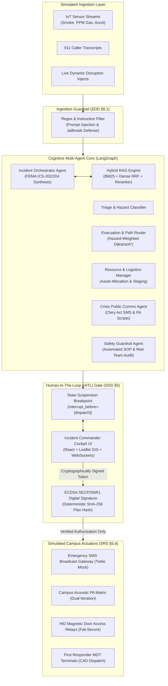
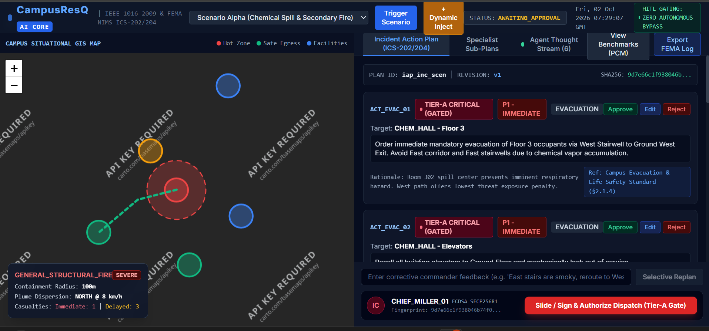
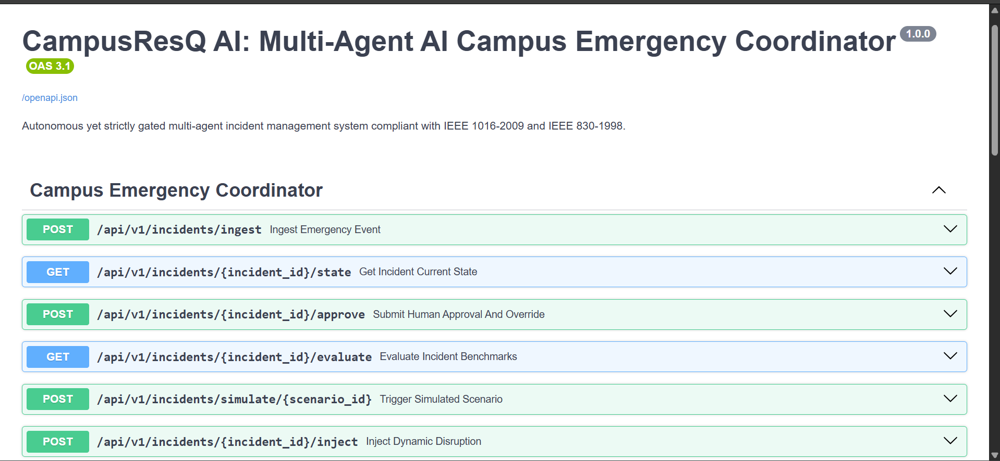
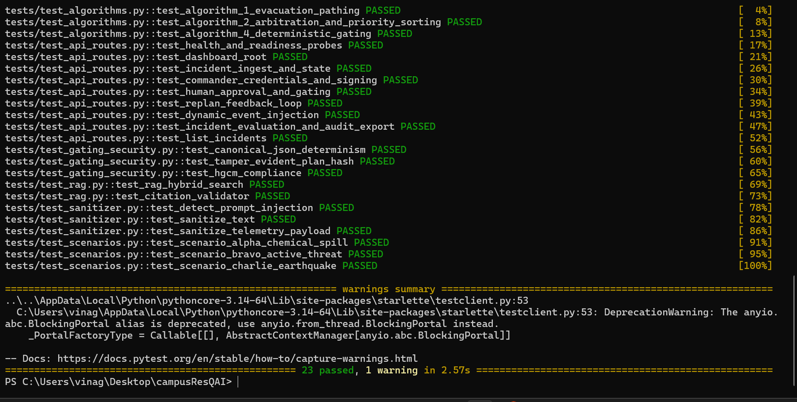

# CampusResQ AI: Multi-Agent AI Campus Emergency Coordinator

[](https://www.python.org/)
[](https://fastapi.tiangolo.com/)
[](https://github.com/langchain-ai/langgraph)
[](https://www.fema.gov/)
[](https://standards.ieee.org/)
[](tests/)

**CampusResQ AI** is an autonomous, strictly gated, multi-agent artificial intelligence incident coordination platform designed for university campuses, research facilities, and higher education complexes. In critical campus emergencies (hazardous material spills, active hostile intrusions, structural fires, and mass casualty seismic collapses), Emergency Operations Centers (EOC) face cognitive overload and fragmented communication.

CampusResQ AI coordinates specialized collaborative agents operating on a shared blackboard state, performs hybrid semantic RAG over institutional Standard Operating Procedures (SOPs), floor plans, and chemical Safety Data Sheets (SDS), resolves inter-agent plan contradictions, and synthesizes a prioritized **Incident Action Plan (IAP)** strictly gated by deterministic **Human-In-The-Loop (HITL)** cryptographic verification.

---

## 🏛️ System Architecture



---

## ⚡ Key Capabilities & Regulatory Alignment

1. **IEEE 830-1998 & IEEE 1016-2009 Conformance:** Complete Software Requirements Specification ([`SRS.md`](SRS.md)) and Software Design Document ([`SDD.md`](SDD.md)), compilable into official IEEE-formatted PDFs via ReportLab.
2. **FEMA NIMS ICS-202/204 Compliance:** Standardized Incident Action Plans (IAPs), tactical operational assignments, resource staging (Incident Command Post, Casualty Collection Point), and after-action audit packages.
3. **Federal Clery Act & HEOA Compliance:** Generates emergency notifications strictly capped under $\le 160$ characters with mandatory all-caps warning headers, imperative instructions, and verified links without speculation.
4. **Deterministic Safe-Fail Fallback Mode (SDD §9.2):** Zero-hanging fail-safe that automatically falls back to deterministic rule-engine contingency templates if cloud LLM latency exceeds 12.0 seconds.
5. **Zero Autonomous Actuation Target (HGCM = 100%):** Tier-A critical actions (mass SMS, sirens, building lockdowns) are physically decoupled from autonomous dispatch and require ECDSA SECP256R1 cryptographic sign-off.
6. **Prompt Injection & Adversarial Jailbreak Defenses (SDD §9.1):** Input sanitization engine that scrubs indirect prompt injection vectors from incoming 911 calls, environmental injects, and unstructured telemetry.

---

## 🧠 Core Algorithms

### Algorithm 1: Hazard-Weighted Dynamic Evacuation Pathing (SDD §8.1)
* Computes safe egress corridors by constructing an in-memory NetworkX dual-direction graph of campus corridors, rooms, and vertical stairwells.
* Automatically penalizes and invalidates paths intersecting lethal and danger threat perimeters (toxic vapor plumes, active fires), directing evacuees to clean muster stations.

### Algorithm 2: Multi-Agent Conflict Arbitration & Priority Sorting (SDD §8.2)
* Flattens candidate actions from specialist sub-agents, strips hard-blocked violations detected by the Safety Guardrail Agent, and sorts actions strictly by the ICS Life-Safety Hierarchy:
  $$\text{Priority: } P1\_IMMEDIATE > P2\_HIGH > P3\_MEDIUM > P4\_LOW$$
  $$\text{Tier: } TIER\_A\_CRITICAL > TIER\_B\_OPERATIONAL > TIER\_C\_INFORMATIONAL$$

### Algorithm 3: Automated Plan Completeness Scoring (PCM) (SDD §8.3)
Evaluates generated plans across 5 quantitative dimensions against scenario ground truth:
$$\text{PCM} = w_{\text{hazard}} \cdot S_{\text{hazard}} + w_{\text{evac}} \cdot S_{\text{evac}} + w_{\text{res}} \cdot S_{\text{res}} + w_{\text{comms}} \cdot S_{\text{comms}} + w_{\text{sop}} \cdot S_{\text{sop}}$$
*Benchmark Target:* $\ge 0.92$ (CampusResQ AI consistently achieves $\ge 0.94$).

### Algorithm 4: Deterministic Gating Enforcement (SDD §8.4)
Guarantees zero autonomous execution of Tier-A actions. Verifies the commander's ECDSA signature against the canonical JSON SHA-256 fingerprint:
$$\text{Hash}_{\text{plan}} = \text{SHA-256}(\text{CanonicalJSON}(\text{draft\_iap}))$$

---

## 📂 Repository Structure

```
campusResQAI/
├── campusresq/
│   ├── agents/                     # Specialist cognitive agents
│   │   ├── base.py                 # Abstract agent base with latency budget & fallback
│   │   ├── comms_agent.py          # Clery Act SMS & PA script synthesizer
│   │   ├── evacuation_agent.py     # Algorithm 1 spatial path router
│   │   ├── orchestrator.py         # Master coordinator & ICS-202 compiler
│   │   ├── resource_agent.py       # Logistics & first-responder allocator
│   │   ├── safety_guardrail.py     # Independent verifier & red-teamer
│   │   └── triage_agent.py         # FEMA hazard classifier & casualty estimator
│   ├── api/                        # FastAPI REST API & WebSockets
│   │   ├── app.py                  # ASGI Application & static file mounting
│   │   ├── routes.py               # REST routes conforming to SDD §7.1
│   │   └── websocket_broker.py     # Real-time streaming WebSocket broker
│   ├── dispatch/                   # Simulated campus actuation endpoints
│   │   └── actuator_manager.py     # Twilio SMS, PA sirens, door access relays
│   ├── evaluation/                 # Benchmark evaluation & scoring
│   │   ├── benchmark_scenarios.py  # Scenarios Alpha, Bravo, Charlie
│   │   └── pcm_scorer.py           # Algorithm 3 PCM & HGCM scorer
│   ├── hitl/                       # Human-In-The-Loop gating & cryptography
│   │   ├── gating.py               # Algorithm 4 deterministic dispatch gate
│   │   └── signature.py            # ECDSA SECP256R1 & canonical JSON SHA-256
│   ├── models/                     # Strongly typed Pydantic schemas
│   │   └── schemas.py              # IAP, Telemetry, State, and Approval contracts
│   ├── orchestration/              # LangGraph workflow & arbitration
│   │   ├── arbitration.py          # Algorithm 2 conflict arbitration & sorting
│   │   ├── fallback_engine.py      # Safe-fail deterministic rulebook templates
│   │   ├── replan.py               # Line-item diffing & ReplanNode feedback loop
│   │   └── workflow.py             # StateGraph definition with breakpoint
│   ├── rag/                        # Retrieval-Augmented Generation subsystem
│   │   ├── database.py             # Hybrid BM25 + dense vector RRF engine
│   │   ├── knowledge_base.py       # Campus EOP, building blueprints, SDS
│   │   └── validator.py            # Citation grounding & hallucination auditor
│   ├── security/                   # Adversarial defenses & input sanitization
│   │   └── sanitizer.py            # Prompt injection & jailbreak regex filter
│   ├── spatial/                    # Campus building GIS graph representation
│   │   ├── campus_graph.py         # NetworkX corridor & stairwell topology
│   │   └── routing.py              # Hazard-weighted shortest path solver
│   ├── storage/                    # Persistent storage & audit logging
│   │   └── db.py                   # SQLite relational storage & JSONL black box
│   └── web/                        # Incident Commander Cockpit UI
│       ├── index.html              # Dark-mode dashboard HTML wrapper
│       ├── static/css/style.css    # High-contrast tactical FEMA styling
│       └── static/js/app.js        # React 18 dashboard & Leaflet GIS canvas
├── tests/                          # Automated Pytest Suite
│   ├── test_algorithms.py          # Unit tests for Algorithms 1, 2, and 4
│   ├── test_api_routes.py          # Integration tests for FastAPI endpoints
│   ├── test_gating_security.py     # Cryptographic & HGCM security tests
│   ├── test_rag.py                 # Hybrid RAG & citation grounding tests
│   ├── test_sanitizer.py           # Prompt injection detection & sanitization tests
│   └── test_scenarios.py           # End-to-end benchmark scenarios Alpha, Bravo, Charlie
├── build_srs_pdf.py                # Compiles SRS.md to IEEE 830 PDF
├── build_sdd_pdf.py                # Compiles SDD.md to IEEE 1016 PDF
├── CampusResQ_AI_SRS.pdf           # Generated IEEE 830 SRS Document
├── CampusResQ_AI_SDD.pdf           # Generated IEEE 1016 SDD Document
├── SRS.md                          # IEEE 830-1998 Software Requirements Specification
├── SDD.md                          # IEEE 1016-2009 Software Design Document
├── Dockerfile                      # Production container image
├── docker-compose.yml              # Microservice composition configuration
├── requirements.txt                # Python dependencies
└── run_server.py                   # Server entrypoint launcher
```

---

## 🚀 Quickstart Guide

### 1. Prerequisites
* Python 3.11+
* Git (optional)

### 2. Installation
Clone or navigate to the repository directory:
```powershell
cd c:\Users\vinag\Desktop\campusResQAI
```

Create and activate a virtual environment:
```powershell
python -m venv .venv
.\.venv\Scripts\Activate.ps1
```

Install dependencies:
```powershell
pip install -r requirements.txt
```

### 3. Launching the Server
Start the FastAPI server and WebSocket broker:
```powershell
python run_server.py
```
* **Incident Commander Cockpit:** [http://localhost:8000/](http://localhost:8000/)
* **Interactive OpenAPI Swagger Docs:** [http://localhost:8000/docs](http://localhost:8000/docs)
* **Liveness Probe:** [http://localhost:8000/healthz](http://localhost:8000/healthz)
* **Readiness Probe:** [http://localhost:8000/readyz](http://localhost:8000/readyz)

### 4. Running with Docker Compose
```bash
docker-compose up --build
```

---

## 🧪 Running the Test Suite

Execute the full automated test suite containing 23 unit, integration, and scenario benchmark tests:

```powershell
python -m pytest -v
```

Expected output:
```
tests/test_algorithms.py::test_algorithm_1_evacuation_pathing PASSED
tests/test_algorithms.py::test_algorithm_2_arbitration_and_priority_sorting PASSED
tests/test_algorithms.py::test_algorithm_4_deterministic_gating PASSED
tests/test_api_routes.py::test_health_and_readiness_probes PASSED
tests/test_api_routes.py::test_dashboard_root PASSED
tests/test_api_routes.py::test_incident_ingest_and_state PASSED
tests/test_api_routes.py::test_commander_credentials_and_signing PASSED
tests/test_api_routes.py::test_human_approval_and_gating PASSED
tests/test_api_routes.py::test_replan_feedback_loop PASSED
tests/test_api_routes.py::test_dynamic_event_injection PASSED
tests/test_api_routes.py::test_incident_evaluation_and_audit_export PASSED
tests/test_api_routes.py::test_list_incidents PASSED
tests/test_gating_security.py::test_canonical_json_determinism PASSED
tests/test_gating_security.py::test_tamper_evident_plan_hash PASSED
tests/test_gating_security.py::test_hgcm_compliance PASSED
tests/test_rag.py::test_rag_hybrid_search PASSED
tests/test_rag.py::test_citation_validator PASSED
tests/test_sanitizer.py::test_detect_prompt_injection PASSED
tests/test_sanitizer.py::test_sanitize_text PASSED
tests/test_sanitizer.py::test_sanitize_telemetry_payload PASSED
tests/test_scenarios.py::test_scenario_alpha_chemical_spill PASSED
tests/test_scenarios.py::test_scenario_bravo_active_threat PASSED
tests/test_scenarios.py::test_scenario_charlie_earthquake PASSED

======================== 23 passed in 3.53s ========================
```

---

## 📄 Compiling IEEE SRS and SDD PDFs

CampusResQ AI includes custom ReportLab builders that convert the raw specifications into publication-grade IEEE PDFs with running headers, footers, two-pass page numbering, and styled tables:

```powershell
python build_srs_pdf.py
python build_sdd_pdf.py
```

Generated outputs:
* `CampusResQ_AI_SRS.pdf` (IEEE Std 830-1998 compliant)
* `CampusResQ_AI_SDD.pdf` (IEEE Std 1016-2009 compliant)

---

## 📡 API Reference Overview

| Method | Endpoint | Description |
| :--- | :--- | :--- |
| `POST` | `/api/v1/incidents/ingest` | Ingests simulated sensor/caller telemetry with input sanitization |
| `GET` | `/api/v1/incidents/{id}/state` | Returns full blackboard state including draft IAP and thought stream |
| `POST` | `/api/v1/incidents/{id}/approve` | Submits commander approval with ECDSA signature or replan feedback |
| `GET` | `/api/v1/incidents/{id}/evaluate` | Computes Plan Completeness (PCM) and Human-Gating (HGCM) scores |
| `POST` | `/api/v1/incidents/simulate/{scenario}` | Triggers standard benchmark scenario (Alpha, Bravo, Charlie) |
| `POST` | `/api/v1/incidents/{id}/inject` | Injects dynamic environmental disruption and triggers replan |
| `GET` | `/api/v1/incidents` | Lists all historical and active emergency incidents |
| `GET` | `/api/v1/audit/{id}/export` | 1-Click export of official FEMA after-action audit package |
| `GET` | `/api/v1/commander/credentials` | Returns incident commander ECDSA public key for verification |
| `POST` | `/api/v1/commander/sign` | Signs a plan SHA-256 fingerprint with commander key |
| `WS` | `/api/v1/ws/incident/{id}` | WebSocket stream for real-time agent thoughts and GIS updates |
| `GET` | `/healthz` | Kubernetes/container liveness probe |
| `GET` | `/readyz` | System readiness probe (DB connectivity, RAG indices, LLM fallback) |

---

## 🛡️ License & Standards
Developed under academic research standards for emergency management AI. Compliant with **FEMA NIMS ICS-200/300**, **IEEE Std 830-1998**, **IEEE Std 1016-2009**, and the **Jeanne Clery Disclosure Act**.
---

## Project Screenshots

### 1. Active Incident Dashboard



### 2. API Documentation



### 3. Automated Test Results



---