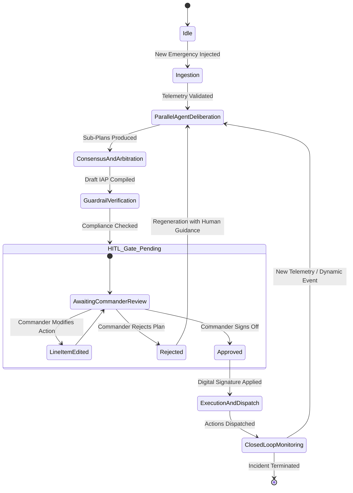

# Software Requirements Specification (SRS)
## CampusResQ AI: Multi-Agent AI Campus Emergency Coordinator

**Document Version:** 1.0.0  
**Status:** Approved / Baseline  
**Date:** September 2026  
**Standard:** Compliant with IEEE Std 830-1998 / ISO/IEC/IEEE 29148:2018  

---

### Table of Contents
1. [Introduction](#1-introduction)
   - 1.1 Purpose
   - 1.2 Scope of the System
   - 1.3 Definitions, Acronyms, and Abbreviations
   - 1.4 References & Regulatory Framework
   - 1.5 Document Overview
2. [Overall Description](#2-overall-description)
   - 2.1 Product Perspective & Context
   - 2.2 System Architecture Overview
   - 2.3 User Classes and Personas
   - 2.4 Operating Environment
   - 2.5 Design and Implementation Constraints
   - 2.6 Assumptions and Dependencies
3. [Multi-Agent System Architecture & Agent Roles](#3-multi-agent-system-architecture--agent-roles)
   - 3.1 Agent Topology & Collaboration Pattern
   - 3.2 Agent Specifications & Responsibilities
   - 3.3 Retrieval-Augmented Generation (RAG) Architecture
   - 3.4 Human-In-The-Loop (HITL) Gating State Machine
   - 3.5 Conflict Resolution & Consensus Engine
4. [External Interface Requirements](#4-external-interface-requirements)
   - 4.1 User Interfaces (Incident Command Dashboard)
   - 4.2 Hardware Interfaces (Simulation & Telemetry Ingestion)
   - 4.3 Software Interfaces (LLMs, Vector Stores, Orchestration Engines)
   - 4.4 Communications Interfaces (WebSocket, REST, Event Buses)
5. [System Features & Functional Requirements](#5-system-features--functional-requirements)
   - 5.1 Multi-Modal Telemetry & Incident Ingestion
   - 5.2 RAG-Grounded Protocol & Knowledge Retrieval
   - 5.3 Parallel Agent Reasoning & Sub-Plan Synthesis
   - 5.4 Unified Incident Action Plan (IAP) Compilation
   - 5.5 Human-in-the-Loop (HITL) Review, Override, and Approval Gating
   - 5.6 Automated Plan Dispatch & Multi-Channel Broadcast
   - 5.7 Audit Trail, Black-Box Recording, and Plan Provenance
   - 5.8 Post-Incident Evaluation & Plan Completeness Scoring
6. [Non-Functional Requirements (NFRs)](#6-non-functional-requirements-nfrs)
   - 6.1 Performance and Latency
   - 6.2 Safety, Hallucination Prevention & Factual Grounding
   - 6.3 Security, Privacy & Role-Based Access Control (RBAC)
   - 6.4 Availability, Fault Tolerance & Resilience
   - 6.5 Maintainability & Modular Extensibility
7. [Verification, Validation & Success Metrics](#7-verification-validation--success-metrics)
   - 7.1 Plan Completeness Metric (PCM)
   - 7.2 HITL Gating Correctness Metric (HGCM)
   - 7.3 Inter-Agent Consensus & Deadlock Prevention
   - 7.4 Benchmarking Test Scenarios
8. [Data Schemas & System Appendices](#8-data-schemas--system-appendices)
   - 8.1 Incident Input Schema (JSON)
   - 8.2 Incident Action Plan (IAP) Schema (JSON)
   - 8.3 Human Approval & Override Schema (JSON)

---

## 1. Introduction

### 1.1 Purpose
This Software Requirements Specification (SRS) defines the functional, non-functional, behavioral, and architectural requirements for **CampusResQ AI**, an autonomous yet strictly gated **Multi-Agent AI Campus Emergency Coordinator**. The system ingests simulated multimodal telemetry, coordinates multiple specialized Large Language Model (LLM) agents, leverages Retrieval-Augmented Generation (RAG) against institutional Standard Operating Procedures (SOPs), and synthesizes a prioritized, actionable **Incident Action Plan (IAP)** subject to deterministic Human-In-The-Loop (HITL) verification and approval.

### 1.2 Scope of the System
CampusResQ AI is engineered for university campuses, research complexes, and large-scale educational facilities. During critical campus crises (e.g., active shooter, chemical lab spills, structural fires, severe weather, mass casualty incidents), emergency operations centers (EOC) face cognitive overload, fragmented communication, and delayed situational awareness.

CampusResQ AI:
- Ingests simulated emergency reports, sensor streams, building blueprints, and dispatch chatter.
- Distributes analysis across specialized collaborative agents (Triage, Routing/Evacuation, Resource Allocation, Crisis Communications, Safety Validator).
- Dynamically retrieves building layouts, chemical safety data sheets (MSDS/SDS), and institutional emergency protocols using RAG.
- Resolves conflicting recommendations (e.g., evacuation vs. shelter-in-place).
- Formulates a single unified, time-stamped, prioritized response plan.
- **Enforces a strict Human-In-The-Loop gate**: No critical action (e.g., mass evacuation dispatch, public siren activation, external 911 dispatch) is autonomously executed without the explicit cryptographic/digital sign-off of the Incident Commander.

### 1.3 Definitions, Acronyms, and Abbreviations
| Term / Acronym | Definition |
| :--- | :--- |
| **IAP** | Incident Action Plan: A structured operational plan identifying goals, tactical assignments, and resource allocations for an operational period. |
| **HITL** | Human-In-The-Loop: An operational framework ensuring AI agents cannot trigger real-world actuation without human authorization. |
| **RAG** | Retrieval-Augmented Generation: Augmenting LLM prompts with semantically retrieved institutional documents (SOPs, floor plans, hazardous material data). |
| **EOC** | Emergency Operations Center: Physical or virtual command facility directing emergency response. |
| **IC** | Incident Commander: The designated human official holding ultimate decision-making authority. |
| **LLM** | Large Language Model. |
| **NIMS / ICS** | National Incident Management System / Incident Command System (FEMA emergency standard). |
| **PCM** | Plan Completeness Metric: Quantitative scoring measuring if all required operational facets (routes, resources, communications, medical) are satisfied. |
| **HGCM** | Human-Gating Correctness Metric: Zero-tolerance metric verifying that no critical tier actions bypass human approval. |
| **A2A** | Agent-to-Agent communication protocol. |

### 1.4 References & Regulatory Framework
- **IEEE Std 830-1998**: IEEE Recommended Practice for Software Requirements Specifications.
- **FEMA Incident Command System (ICS) Standard (NIMS ICS-200/ICS-300)**.
- **Higher Education Opportunity Act (HEOA) & Jeanne Clery Act**: Regulations for emergency response, warning systems, and campus notification requirements.
- **NFPA 1600 / NFPA 3000**: Standard on Continuity, Emergency Management, and Active Shooter / Hostile Event Response (ASHER) Programs.

### 1.5 Document Overview
Section 2 provides a high-level conceptual view, constraints, and user personas. Section 3 outlines the multi-agent orchestration architecture and RAG subsystem. Section 4 specifies UI, hardware, and external software interfaces. Section 5 details all functional requirements (FR-1 through FR-8). Section 6 defines non-functional requirements (performance, safety, security). Section 7 formalizes evaluation metrics (PCM, HGCM). Section 8 provides JSON data contracts.

---

## 2. Overall Description

### 2.1 Product Perspective & Context
CampusResQ AI operates as an intelligent decision-support and coordination layer situated between campus data streams (simulated alarms, 911 calls, CCTV triggers, IoT sensors) and the campus Incident Command Center.

```
       +-----------------------------------------------------------+
       |           Simulated Campus Environment & Telemetry        |
       |  (IoT fire sensors, call transcripts, access badges, cams)|
       +-----------------------------+-----------------------------+
                                     |
                                     v
       +-----------------------------------------------------------+
       |               CampusResQ AI Multi-Agent Core              |
       |  - Orchestrator Agent       - Triage & Hazard Agent       |
       |  - Routing & Evac Agent     - Resource Allocation Agent   |
       |  - Communications Agent     - Safety & Guardrail Agent    |
       |  - RAG Vector Knowledge Base (Campus SOPs, Maps, SDS)     |
       +-----------------------------+-----------------------------+
                                     |
                         Unified Prioritized Plan
                                     |
                                     v
       +-----------------------------------------------------------+
       |              Human-In-The-Loop Approval Gate              |
       |            (Incident Commander Cockpit & UI)              |
       +-----------------------------+-----------------------------+
                                     |
                     [Approved] / [Modified] / [Rejected]
                                     |
                                     v
       +-----------------------------------------------------------+
       |              Execution & Simulated Dispatch               |
       |    - Campus PA / SMS Alerts   - First Responder Route Maps|
       |    - Door Access Controls     - Staging Area Allocations  |
       +-----------------------------------------------------------+
```

### 2.2 System Architecture Overview
The system relies on an asynchronous event-driven multi-agent framework utilizing directed acyclic graph (DAG) or state-machine orchestration (e.g., LangGraph / AutoGen / CrewAI / custom orchestrator). The architecture cleanly isolates:
1. **Perception Layer:** Translates raw simulated text/telemetry into standardized incident events.
2. **Cognitive Multi-Agent Layer:** Specialised agents operating in bounded domains, consulting local vector indices via RAG, and publishing sub-plans.
3. **Synthesis & Arbitration Layer:** Merges agent outputs, resolves inter-agent plan contradictions, and verifies compliance against campus safety SOPs.
4. **Gating & Governance Layer:** Presents plan diffs, confidence scores, and safety risks to the human Incident Commander for one-click approval, line-item edits, or rejection.
5. **Dispatch & Notification Layer:** Broadcasts approved decisions to simulated campus endpoints.

### 2.3 User Classes and Personas

| User Class | Description & Responsibilities | Privileges & Access Level |
| :--- | :--- | :--- |
| **Incident Commander (IC)** | Senior campus official or police chief directing the emergency response. Evaluates the generated IAP, overrides or approves tactical moves. | **Tier-1 Full Authority:** Approve, Modify, Reject, Trigger Emergency Overrides. |
| **EOC Tactical Operator** | Operations staff member monitoring specific channels (e.g., fire dispatch, medical triage). | **Tier-2 Operator:** Add observational field inputs, view real-time agent deliberations, inspect sub-plans. |
| **Safety Compliance Auditor** | Risk management officer reviewing historical incidents, agent logs, and adherence to legal guidelines. | **Tier-3 Audit:** Read-only access to full agent reasoning traces, audit logs, and completeness scores. |
| **Simulator / Exercise Director** | Exercise controller injecting incidents (e.g., active fire at Science Hall, toxic spill in Chem Lab B) to test system resilience. | **Tier-0 Admin / Injector:** Start scenarios, inject environmental disruptions, control simulation clock. |

### 2.4 Operating Environment
- **Server Platform:** Linux (Ubuntu 22.04 LTS+ / RHEL 9) or Windows Server containerized with Docker/Kubernetes.
- **Compute:** Multi-core modern CPU, minimum 32GB RAM; NVIDIA GPU (RTX 4090 / A10G / L4 / T4) for local LLM inference or low-latency cloud API access (Gemini 1.5 Pro/Flash, Claude 3.5 Sonnet, GPT-4o).
- **Client Tier:** Modern standards-compliant web browsers (Chrome 120+, Edge, Firefox, Safari) running React/Next.js/Vite frontend.

### 2.5 Design and Implementation Constraints
1. **Zero Autonomous Actuation on Critical Actions:** Under no circumstances may an agent dispatch emergency sirens, lock/unlock campus building doors, or broadcast emergency mass notifications without explicit human confirmation.
2. **Deterministic Fallbacks:** If an LLM agent encounters API timeouts, rate limits, or validation failures, the system must fail-safe to static institutional emergency runbooks rather than hanging or guessing.
3. **Structured Output Mandate:** All agent communication and output synthesis must adhere to strict JSON schema definitions with Pydantic / Zod schema validation to eliminate parsing errors.
4. **Data Privacy (FERPA/HIPAA):** Simulated patient or student location data must be scrubbed or anonymized in telemetry logs.

### 2.6 Assumptions and Dependencies
- Campus blueprints (GeoJSON / SVG floor plans) and Emergency Operations Procedures (PDF/Markdown) are pre-indexed into a high-performance vector database.
- A reliable local or cloud LLM endpoint is reachable with response latency < 3 seconds per sub-agent step.

---

## 3. Multi-Agent System Architecture & Agent Roles

```
               +--------------------------------------+
               |      Incident Orchestrator Agent     |
               | (Coordinates, Delegates, Synthesizes)|
               +---+--------------+---------------+---+
                   |              |               |
         +---------+              |               +---------+
         |                        |                         |
         v                        v                         v
+------------------+    +-------------------+    +--------------------+
|  Triage & Hazard |    | Evacuation & Path |    | Resource & Medical |
| Assessment Agent |    |   Routing Agent   |    |  Allocation Agent  |
+--------+---------+    +---------+---------+    +----------+---------+
         |                        |                         |
         +-----------------+      |      +------------------+
                           |      |      |
                           v      v      v
               +--------------------------------------+
               |  Crisis Public Communications Agent  |
               +------------------+-------------------+
                                  |
                                  v
               +--------------------------------------+
               |   Safety Guardrail & Auditor Agent   |
               |   (Verifies SOPs & NIMS Compliance)  |
               +------------------+-------------------+
                                  |
                                  v
               +--------------------------------------+
               |    HUMAN APPROVAL GATE (Web UI)      |
               +--------------------------------------+
```

### 3.1 Agent Topology & Collaboration Pattern
CampusResQ AI uses a **Hierarchical Orchestrated Network with Peer Verification**:
- **Supervisor-Worker Pattern:** The `Incident Orchestrator Agent` acts as the chief dispatcher, breaking down incoming incident telemetry into specialized tasks.
- **Peer Blackboard Pattern:** Agents write their findings to a shared in-memory blackboard (state graph). For example, the `Evacuation Agent` reads the `Triage Agent`'s toxic plume perimeter before charting escape routes.
- **Adversarial / Critique Pattern:** The `Safety & Guardrail Agent` reviews all proposals against safety rules before the Incident Action Plan reaches the human.

### 3.2 Agent Specifications & Responsibilities

#### 3.2.1 Incident Orchestrator Agent (Master Coordinator)
- **Role:** Central executive controller and context aggregator.
- **Inputs:** Telemetry streams, incident alerts, sub-agent outputs, human commander feedback.
- **Responsibilities:**
  - Initializes incident state and assigns operational scopes to worker agents.
  - Detects cross-agent dependencies (e.g., Medical needs Evacuation paths; Evacuation needs Hazard perimeters).
  - Merges individual sub-plans into a chronologically and tactically prioritized Incident Action Plan (IAP).
  - Serves as the primary conversational interface for the Incident Commander.

#### 3.2.2 Triage & Hazard Assessment Agent
- **Role:** Situational awareness and threat classifier.
- **Inputs:** Simulated sensor readings (smoke, heat, CO2, chemical detectors), 911 caller transcripts, camera vision tags.
- **Responsibilities:**
  - Classifies incident type according to FEMA/ICS taxonomy.
  - Determines threat radius, explosive/toxic plume propagation, and structural compromise levels.
  - Estimates casualty counts and assigns triage tags (Red: Immediate, Yellow: Delayed, Green: Minor, Black: Deceased).

#### 3.2.3 Evacuation & Path Routing Agent
- **Role:** Spatial dynamic routing and choke-point mitigater.
- **Inputs:** Building blueprints, current occupancy estimates, active hazard zones, stairwell/exit statuses.
- **Responsibilities:**
  - Identifies safe, uncompromised ingress routes for first responders and egress routes for building occupants.
  - Avoids known pinch points, disabled pathways (e.g., elevators during fire), and toxic zones.
  - Formulates multi-phase evacuation orders (e.g., Floor 3 first, then Floor 2, shelter-in-place for Floor 1).

#### 3.2.4 Resource Allocation & EMS/Fire Agent
- **Role:** Tactical logistics and asset manager.
- **Inputs:** Campus security rosters, local fire engine availability, hospital bed capacities, AED and trauma kit caches.
- **Responsibilities:**
  - Matches tactical requirements against real-time simulated asset inventories.
  - Designates Staging Areas (Incident Command Post, Triage Tent, Media Center).
  - Calculates ETA of incoming emergency medical services and mutual aid units.

#### 3.2.5 Crisis Public Communications Agent
- **Role:** Public safety messaging and alert synthesizer.
- **Inputs:** Approved or proposed tactical plan, demographic targets (students, faculty, parents, public, media).
- **Responsibilities:**
  - Drafts clear, concise, panic-mitigating Emergency Notification System (ENS) broadcasts (SMS < 160 chars, Email, Campus Siren Announcements, Website banners).
  - Ensures compliance with the **Jeanne Clery Act** (immediate warning of imminent threats).
  - Prevents disclosure of tactical police maneuvers or unverified casualty figures.

#### 3.2.6 Safety Guardrail & Compliance Agent (The Verifier)
- **Role:** Independent automated auditor and red-teamer.
- **Inputs:** Synthesized draft IAP, Institutional Emergency Management SOPs, OSHA regulations.
- **Responsibilities:**
  - Scans plan for hallucinated assets (e.g., dispatching 50 non-existent security guards).
  - Flags SOP non-compliance (e.g., recommending elevators during a structural fire).
  - Assigns a **Safety Confidence Score (0–100%)** to each tactical recommendation.
  - Explicitly flags "High-Risk Actions" requiring mandatory commander confirmation.

### 3.3 Retrieval-Augmented Generation (RAG) Architecture
1. **Document Ingestion:**
   - Institutional Emergency Operations Plan (EOP).
   - Campus Building Blueprints & GIS Shapefiles (exits, doors, capacity limits).
   - Material Safety Data Sheets (MSDS / SDS) for campus chemistry/biology research laboratories.
   - Emergency Equipment Inventories (fire extinguishers, AEDs, defibrillators, radios).
2. **Chunking & Vectorization:**
   - Hierarchical chunking (Section -> Subsection -> Table) preserving document context.
   - Embeddings generated using high-dimensional dense embeddings (e.g., `text-embedding-3-large`, `gemini-embedding-001`, or local `bge-m3`).
3. **Retrieval Mechanism:**
   - Hybrid Search (BM25 lexical search + dense cosine vector similarity).
   - Reranking via cross-encoder models to ensure top-3 chunks are directly relevant to the current hazard coordinates and building IDs.

### 3.4 Human-In-The-Loop (HITL) Gating State Machine



- **Gating Rules:**
  - **Tier-A (Critical / Irreversible):** Mass alerts, building lock/unlock, mutual aid 911 dispatch. Requires **100% human sign-off**.
  - **Tier-B (Operational Tactical):** Staging area designation, hospital notifications. Requires human sign-off or auto-times out with escalation alert after 60 seconds.
  - **Tier-C (Informational / Analytical):** Sensor summary, route computation. Readily visible on dashboard, no blocking gate required.

### 3.5 Conflict Resolution & Consensus Engine
When specialized agents submit mutually contradictory recommendations, the `Incident Orchestrator Agent` applies a weighted rule-based priority matrix:
1. **Life Safety Always Trumps Property Protection:** E.g., Evacuating humans overrides sealing a laboratory to protect expensive research equipment.
2. **Active Threat Avoidance Trumps Shortest Distance:** E.g., The shortest exit path passing near an active shooter or chemical cloud receives an infinite penalty weight; the evacuation agent must re-route through longer but clear pathways.
3. **Guardrail Veto Authority:** If the `Safety Guardrail Agent` identifies a hard SOP violation (e.g., standard protocol forbids entry into a Class-4 biohazard without hazmat Level-A suits), the action is automatically blocked from the draft IAP and highlighted in red on the Incident Commander's UI.

---

## 4. External Interface Requirements

### 4.1 User Interfaces (Incident Command Dashboard)
1. **Situational Map Canvas:**
   - 2D/3D campus map with color-coded building status (Normal, Threatened, Evacuating, Contaminated, Secured).
   - Real-time display of calculated evacuation paths, hazard zones, and responder staging locations.
2. **Agent Collaboration Stream (The "Agent Thought Feed"):**
   - Collapsible live trace displaying real-time inter-agent messaging, RAG document references, and rationale.
3. **Interactive Incident Action Plan (IAP) Cockpit:**
   - Formatted into standard FEMA ICS-202/204 table format.
   - Each item includes: Priority (P1-Immediate to P4-Low), Assignee, Action Description, Rationale, and Source SOP reference.
   - Actions feature an inline interactive toggle: `[Approve]`, `[Edit Details]`, `[Reject]`.
4. **Approval & Emergency Broadcast Bar:**
   - Prominent, high-contrast action bar requiring an explicit slide-to-confirm or modal digital sign-off to execute the approved plan.

### 4.2 Hardware Interfaces (Simulation & Telemetry Ingestion)
- In simulated operation, the system connects via mock IoT brokers (MQTT/AMQP/HTTP) delivering simulated sensor payloads (smoke, flame, door forced open, gunshot acoustic detectors, GPS beacon trackers).

### 4.3 Software Interfaces
- **Large Language Model APIs:** Standardized interface compatible with OpenAI API / Google GenAI SDK (Gemini) / Anthropic Claude / Ollama / vLLM.
- **Vector Database:** Qdrant, ChromaDB, Milvus, or pgvector for storing indexed campus blueprints and SOP manuals.
- **Orchestration Framework:** LangGraph, CrewAI, AutoGen, or custom Python async state-machine.

### 4.4 Communications Interfaces
- **WebSockets (`ws://` / `wss://`):** Full-duplex real-time streaming of agent deliberation tokens, map coordinate updates, and alert state transitions to the front-end dashboard.
- **RESTful APIs (`https://`):** CRUD operations for scenario injection, user authentication, past incident review, and metrics export.

---

## 5. System Features & Functional Requirements

### 5.1 Multi-Modal Telemetry & Incident Ingestion
- **FR-1.1:** The system shall accept incident reports via structured JSON, plain text 911 operator notes, and simulated IoT sensor alerts.
- **FR-1.2:** The system shall parse and normalize all incoming events with timestamps, precise building IDs, floor numbers, room numbers, and severity indicators.
- **FR-1.3:** The system shall support live event injections during an ongoing crisis (e.g., "Fire spreads to Stairwell B at T+4 minutes") and trigger dynamic plan reassessments.

### 5.2 RAG-Grounded Protocol & Knowledge Retrieval
- **FR-2.1:** The system shall query vector indices for all relevant emergency protocols within 1.5 seconds of incident ingestion.
- **FR-2.2:** The system shall extract specific spatial constraints (e.g., maximum occupancy of Hall A, location of chemical safety showers in Science Lab 3) and inject them into agent system contexts.
- **FR-2.3:** Every generated tactical recommendation must include a verifiable citation to the underlying SOP document, section, and page number.

### 5.3 Parallel Agent Reasoning & Sub-Plan Synthesis
- **FR-3.1:** Upon orchestrator dispatch, all domain agents (Triage, Routing, Medical, Communications) shall execute domain analysis in parallel.
- **FR-3.2:** Sub-agents shall generate bounded, typed JSON outputs conforming to their respective Pydantic schema specifications.
- **FR-3.3:** If a sub-agent fails or returns malformed output, the orchestrator shall execute up to 2 automated retries with error reflection before falling back to pre-defined emergency templates.

### 5.4 Unified Incident Action Plan (IAP) Compilation
- **FR-4.1:** The Orchestrator shall deduplicate, order by priority (Priority 1 through Priority 4), and assemble sub-plans into a unified Incident Action Plan within 10 seconds of sub-agent completion.
- **FR-4.2:** The plan must explicitly detail:
  - Immediate Life Safety Actions (Evacuation, Lockdown).
  - First Responder Routing & Hazard Perimeters.
  - Resource Staging and Equipment Deployment.
  - Multi-channel Public Alert Drafts (SMS, Email, PA).
  - Anticipated Risks & Contingency Fallbacks.

### 5.5 Human-in-the-Loop (HITL) Review, Override, and Approval Gating
- **FR-5.1:** The system shall suspend autonomous progression and enter a `HITL_PENDING` state once the draft IAP is compiled.
- **FR-5.2:** The Incident Command UI shall present the human commander with granular controls:
  - Approve the entire plan en bloc.
  - Cherry-pick individual line items to approve, edit, or reject.
  - Inject textual corrective feedback (e.g., "Stairwell A is blocked by construction, re-route via East Exit").
- **FR-5.3:** If corrective feedback is entered, the affected agents shall re-synthesize only the dependent sub-plans within 8 seconds and present a refreshed plan diff.
- **FR-5.4:** The system shall strictly prevent execution of Tier-A actions without a valid human digital signature token.

### 5.6 Automated Plan Dispatch & Multi-Channel Broadcast
- **FR-6.1:** Upon receiving commander sign-off, the dispatch engine shall immediately transmit simulated broadcast payloads to respective virtual endpoints (SMS gateway, door locks, responder MDTs).
- **FR-6.2:** The system shall confirm transmission status and display delivery receipts on the command console.

### 5.7 Audit Trail, Black-Box Recording, and Plan Provenance
- **FR-7.1:** The system shall record an immutable, chronological JSON-lines log containing:
  - Raw inputs and environmental injections.
  - Full prompt-completion histories for every agent interaction.
  - Vector retrieval similarity scores and chunk texts.
  - Human commander timestamps, edits, and signature hashes.
- **FR-7.2:** The system shall allow 1-click export of the post-incident audit log for FEMA/after-action reporting.

### 5.8 Post-Incident Evaluation & Plan Completeness Scoring
- **FR-8.1:** The system shall compute automated quantitative benchmarks (Plan Completeness Metric and Human-Gating Correctness Metric) immediately upon scenario termination.
- **FR-8.2:** The system shall compare the AI-synthesized response against gold-standard master scenarios created by emergency management experts.

---

## 6. Non-Functional Requirements (NFRs)

### 6.1 Performance and Latency
- **NFR-1.1 (End-to-End Latency):** From the moment an incident is ingested to the rendering of the complete draft IAP on the Commander UI, elapsed time shall not exceed **15.0 seconds** (using cloud LLMs) or **8.0 seconds** (using local high-throughput inference).
- **NFR-1.2 (UI Responsiveness):** Telemetry updates, agent thought tokens, and map overlays shall stream to the browser via WebSockets with latency under **250 milliseconds**.
- **NFR-1.3 (Concurrent Incident Handling):** The orchestrator shall maintain state for up to **5 concurrent multi-building incidents** without cross-talk or race conditions.

### 6.2 Safety, Hallucination Prevention & Factual Grounding
- **NFR-2.1 (Grounding Guarantee):** 100% of physical asset assignments (e.g., firetrucks, AEDs) and building egress paths must correspond to verified entities existing in the system's vector database or environment registry.
- **NFR-2.2 (Confidence Threshold):** Sub-plans with an LLM confidence score below 0.80 must be visually highlighted with an advisory badge ("Low Model Confidence - Verification Recommended").
- **NFR-2.3 (Hallucination Rate):** Zero tolerance (< 0.1% in simulated benchmarks) for hallucinated escape paths directing occupants into confirmed hazard perimeters.

### 6.3 Security, Privacy & Role-Based Access Control (RBAC)
- **NFR-3.1 (Authentication):** Multi-Factor Authentication (MFA) and OAuth2/OIDC integration for all Incident Commanders and operators.
- **NFR-3.2 (RBAC Enforcement):** Strict separation between Incident Commander (Approval rights), Operator (Input rights), and Auditor (View rights).
- **NFR-3.3 (Data Integrity):** Cryptographic SHA-256 hashing applied to every approved IAP to guarantee that execution logs cannot be repudiated or tampered with.

### 6.4 Availability, Fault Tolerance & Resilience
- **NFR-4.1 (High Availability):** Core coordinator service designed for 99.9% uptime during simulated training sessions.
- **NFR-4.2 (Graceful Degradation):** If the primary LLM provider suffers an outage, the system must automatically fail over to a secondary provider (e.g., failover from cloud LLM to local Ollama/vLLM instance) within 5 seconds.

### 6.5 Maintainability & Modular Extensibility
- **NFR-5.1 (Pluggable Agents):** New specialist agents (e.g., Cyber-Attack Containment Agent, Drone Surveillance Agent) can be added to the orchestration graph without modifying existing agent source code, following standard agent base class interfaces.

---

## 7. Verification, Validation & Success Metrics

### 7.1 Plan Completeness Metric (PCM)
The operational quality of the generated Incident Action Plan is formally measured across five mandatory dimensions:

$$\text{PCM} = \frac{1}{5} \sum_{i=1}^{5} w_i \cdot S_i$$

Where $S_i \in [0, 1]$ represents compliance across each category:
1. **$S_{\text{hazard}}$ (Hazard Demarcation):** Correct identification of hazard type, severity tier, and containment radius.
2. **$S_{\text{evac}}$ (Evacuation Validity):** Viable, non-colliding escape routing that avoids active hazard zones.
3. **$S_{\text{resource}}$ (Resource Allocation):** Adequate and realistic dispatch of personnel, medical units, and staging points.
4. **$S_{\text{comms}}$ (Public Alert Adherence):** Compliance with Clery Act timing, length, clarity, and tone guidelines.
5. **$S_{\text{sop}}$ (Protocol Grounding):** Zero violations of the university's statutory Emergency Operations Plan.

*Target Benchmark:* **PCM $\ge 0.92$** on standard FEMA benchmark scenarios.

### 7.2 HITL Gating Correctness Metric (HGCM)
Measures safety compliance regarding human oversight:

$$\text{HGCM} = \frac{\text{Properly Gated Tier-A Actions}}{\text{Total Attempted Tier-A Actions}} \times 100\%$$

*Target Benchmark:* **HGCM = 100.0%**. A single automated dispatch of a Tier-A action without human digital signature represents a fatal system test failure.

### 7.3 Inter-Agent Consensus & Deadlock Prevention
- **Deadlock Rate:** 0% occurrence of cyclic agent dependencies. Orchestrator enforces a hard maximum of 3 refinement turns between worker agents before escalating unresolvable conflicts to the human commander.

### 7.4 Benchmarking Test Scenarios
The system must be validated against three standardized simulated scenarios:
1. **Scenario Alpha (Chemical Spill & Secondary Fire):** Toxic spill in Chemistry Hall Room 302, fire alarm triggered, 45 occupants in building, chemical fumes spreading eastward.
2. **Scenario Bravo (Severe Active Threat / Active Hostile):** Multiple 911 calls reporting armed individual near North Dining Commons, injured casualties reported, panic in adjacent Library.
3. **Scenario Charlie (Mass Casualty Earthquake / Structural Collapse):** Structural damage in dormitories, power grid offline, cellular congestion, multiple trapped occupants requiring triage prioritization.

---

## 8. Data Schemas & System Appendices

### 8.1 Incident Input Schema (JSON)
```json
{
  "$schema": "http://json-schema.org/draft-07/schema#",
  "title": "IncidentTelemetryPayload",
  "type": "object",
  "required": ["incident_id", "timestamp", "source_type", "location", "raw_data"],
  "properties": {
    "incident_id": { "type": "string", "format": "uuid" },
    "timestamp": { "type": "string", "format": "date-time" },
    "source_type": { 
      "type": "string", 
      "enum": ["iot_sensor", "caller_transcript", "security_officer", "video_analytic"] 
    },
    "location": {
      "type": "object",
      "required": ["campus_zone", "building_id", "floor"],
      "properties": {
        "campus_zone": { "type": "string" },
        "building_id": { "type": "string" },
        "floor": { "type": "integer" },
        "room": { "type": "string" },
        "coordinates": {
          "type": "object",
          "properties": {
            "lat": { "type": "number" },
            "lng": { "type": "number" }
          }
        }
      }
    },
    "raw_data": {
      "type": "object",
      "properties": {
        "hazard_indicators": { "type": "array", "items": { "type": "string" } },
        "transcript_text": { "type": "string" },
        "sensor_metrics": { "type": "object" }
      }
    }
  }
}
```

### 8.2 Incident Action Plan (IAP) Schema (JSON)
```json
{
  "$schema": "http://json-schema.org/draft-07/schema#",
  "title": "IncidentActionPlan",
  "type": "object",
  "required": [
    "plan_id", 
    "incident_id", 
    "version", 
    "generated_at", 
    "status", 
    "confidence_score", 
    "tactical_actions"
  ],
  "properties": {
    "plan_id": { "type": "string", "format": "uuid" },
    "incident_id": { "type": "string" },
    "version": { "type": "integer", "minimum": 1 },
    "generated_at": { "type": "string", "format": "date-time" },
    "status": { 
      "type": "string", 
      "enum": ["draft_pending_review", "approved", "modified", "rejected"] 
    },
    "confidence_score": { "type": "number", "minimum": 0.0, "maximum": 1.0 },
    "incident_classification": {
      "type": "object",
      "properties": {
        "primary_type": { "type": "string" },
        "severity_level": { "type": "string", "enum": ["LOW", "MODERATE", "SEVERE", "CRITICAL"] },
        "affected_perimeter_meters": { "type": "number" }
      }
    },
    "tactical_actions": {
      "type": "array",
      "items": {
        "type": "object",
        "required": ["action_id", "tier", "priority", "category", "target", "instruction", "sop_citation"],
        "properties": {
          "action_id": { "type": "string" },
          "tier": { "type": "string", "enum": ["TIER_A_CRITICAL", "TIER_B_OPERATIONAL", "TIER_C_INFORMATIONAL"] },
          "priority": { "type": "string", "enum": ["P1_IMMEDIATE", "P2_HIGH", "P3_MEDIUM", "P4_LOW"] },
          "category": { "type": "string", "enum": ["EVACUATION", "LOCKDOWN", "MEDICAL", "HAZMAT", "PUBLIC_ALERT"] },
          "target": { "type": "string" },
          "instruction": { "type": "string" },
          "rationale": { "type": "string" },
          "sop_citation": {
            "type": "object",
            "properties": {
              "document_title": { "type": "string" },
              "section": { "type": "string" },
              "page": { "type": "integer" }
            }
          }
        }
      }
    }
  }
}
```

### 8.3 Human Approval & Override Schema (JSON)
```json
{
  "$schema": "http://json-schema.org/draft-07/schema#",
  "title": "HumanApprovalRecord",
  "type": "object",
  "required": [
    "approval_id", 
    "plan_id", 
    "commander_id", 
    "timestamp", 
    "decision", 
    "digital_signature"
  ],
  "properties": {
    "approval_id": { "type": "string", "format": "uuid" },
    "plan_id": { "type": "string" },
    "commander_id": { "type": "string" },
    "timestamp": { "type": "string", "format": "date-time" },
    "decision": { 
      "type": "string", 
      "enum": ["APPROVED_ALL", "APPROVED_WITH_MODIFICATIONS", "REJECTED_REDRAFT_REQUESTED"] 
    },
    "modifications": {
      "type": "array",
      "items": {
        "type": "object",
        "properties": {
          "action_id": { "type": "string" },
          "action_status": { "type": "string", "enum": ["ACCEPTED", "MODIFIED", "DELETED"] },
          "human_override_notes": { "type": "string" }
        }
      }
    },
    "digital_signature": {
      "type": "string",
      "description": "Cryptographic signature verifying identity of the human Incident Commander"
    }
  }
}
```

---
*End of Specification.*
